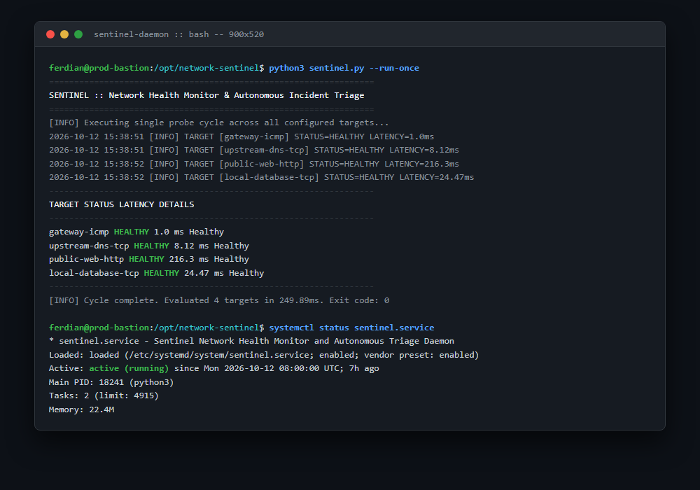
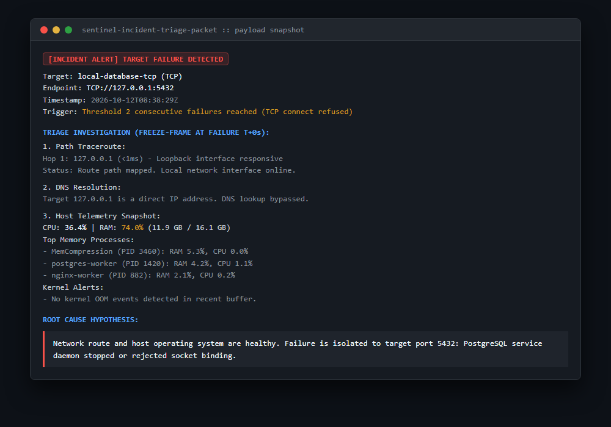

# Sentinel: Network Health Monitor with Autonomous Incident Triage

[](https://github.com/ferdianhanif/network-sentinel-triage/actions/workflows/ci.yml)
[](https://www.python.org/)
[](LICENSE)

An asynchronous network and host health daemon built for Linux environments. When an endpoint or service fails, Sentinel immediately freezes diagnostic telemetry (hop route traceroute, DNS resolver checks, host CPU and memory consumption, and kernel out-of-memory events) at the exact moment of failure, delivering actionable root cause hypotheses before transient symptoms disappear.

---

## Previews

### CLI Execution and Systemd Service Status


### Autonomous Incident Triage Packet


---

## Operational Problem

Standard infrastructure monitors (such as simple ping scripts or web uptime checkers) alert teams that a service is down, but provide zero context about why:

1. **Transient and Intermittent Flaps**: Transient network dropouts or container crashes often recover before an engineer can open an SSH session, leaving behind no diagnostic evidence.
2. **Delayed Investigation Time (MTTR)**: On-call engineers must manually run ping, traceroute, dig, and inspect host memory and dmesg logs while under incident pressure.
3. **Notification Storms**: Flapping interfaces often generate hundreds of redundant alerts within minutes, causing alert fatigue.

Sentinel acts as an autonomous first responder. It runs continuously as a low-overhead systemd daemon, debounces flapping connections, and captures live diagnostic evidence the moment a configured failure threshold is breached.

---

## Architecture and Flow

```
Target Definitions (config/targets.yaml)
                  │
                  ▼
          Prober Engine Loop
                  │
  ┌───────────────┼───────────────┐
  ▼               ▼               ▼
Layer 3 (ICMP)  Layer 4 (TCP)   Layer 7 (HTTP)
  │               │               │
  └───────────────┬───────────────┘
                  │
                  ▼
         Flap Damping Check
                  │
      Threshold Reached?
        /            \
      No              Yes
      /                \
 Record Metric      Trigger First-Responder Triage
 (Keep Polling)           │
                  ┌───────┴───────┐
                  ▼               ▼
            Network Triage  Host Telemetry
            - Traceroute    - CPU & RAM%
            - DNS lookup    - Top processes
                            - Kernel dmesg OOM
                  │               │
                  └───────┬───────┘
                          │
                          ▼
              Formulate Hypothesis
                          │
                          ▼
           Dispatch Incident Packet
           (JSONL logs & Telegram alert)
```

---

## Features

- **Multi-Layer Probing**:
  - **Layer 3 (ICMP)**: Round-trip time (RTT) and packet drop detection across Linux and Windows.
  - **Layer 4 (TCP)**: Socket handshake measurement and connection refusal detection.
  - **Layer 7 (HTTP/HTTPS)**: Status code verification, latency measurement, and configurable SSL validation.
- **Flap Damping and Debounce**: Requires `N` consecutive failures before declaring an incident, combined with a cooldown timer to suppress notification spam.
- **Automated Diagnostic Triage**:
  - Path traceroute to isolate gateway drops versus remote ISP dropouts.
  - DNS resolution audit against system resolvers.
  - Host telemetry snapshot capturing top memory-consuming processes and Linux kernel OOM killer events.
- **Hypothesis Formulation**: Generates direct, factual root cause assessments based on correlated network and host data.
- **Zero Heavy Dependencies**: Built using standard Python libraries and lightweight psutil for resource inspection.

---

## Project Structure

```
network-sentinel-triage/
├── .github/
│   └── workflows/
│       └── ci.yml               # Automated test matrix across Python versions
├── config/
│   └── targets.yaml             # Target endpoint and polling configuration
├── docs/
│   └── previews/                # Visual evidence and terminal captures
├── scripts/
│   └── generate_previews.py     # Playwright screenshot generator
├── src/
│   ├── models.py                # Dataclasses and enums
│   ├── probers/
│   │   ├── icmp_prober.py       # Layer 3 ICMP ping prober
│   │   ├── tcp_prober.py        # Layer 4 TCP socket prober
│   │   └── http_prober.py       # Layer 7 HTTP/HTTPS status prober
│   ├── triage/
│   │   ├── traceroute_triage.py # Route hop tracer
│   │   ├── dns_triage.py        # Hostname resolution checker
│   │   └── host_telemetry.py    # Host CPU, memory, and dmesg collector
│   ├── notifiers/
│   │   ├── json_logger.py       # Structured JSONL and event logger
│   │   └── telegram_notifier.py # Clean markdown incident dispatcher
│   └── engine.py                # Core scheduler, debounce, and triage orchestrator
├── systemd/
│   └── sentinel.service         # Hardened Linux systemd service unit
├── tests/
│   └── test_sentinel.py         # Mock and simulation test suite
├── sentinel.py                  # CLI and daemon entrypoint
├── requirements.txt             # Runtime dependencies
└── README.md
```

---

## Quick Start

### 1. Requirements
- Python 3.10 or higher
- Linux (Ubuntu, Debian, RHEL) or Windows

### 2. Installation
```bash
git clone https://github.com/ferdianhanif/network-sentinel-triage.git
cd network-sentinel-triage

python3 -m venv venv
source venv/bin/activate
pip install -r requirements.txt
```

### 3. Configuration
Edit `config/targets.yaml` to specify target endpoints and alert parameters:

```yaml
global:
  probe_interval_seconds: 10
  cooldown_seconds: 60
  log_file: "logs/sentinel.log"
  incident_log_file: "logs/incidents.jsonl"

targets:
  - name: "gateway-icmp"
    type: "icmp"
    host: "192.168.1.1"
    threshold: 3
    timeout_seconds: 1.0

  - name: "upstream-dns-tcp"
    type: "tcp"
    host: "1.1.1.1"
    port: 53
    threshold: 3
    timeout_seconds: 2.0

  - name: "production-api-http"
    type: "http"
    url: "https://api.internal.corp/health"
    expected_status: 200
    threshold: 3
    timeout_seconds: 3.0
```

### 4. Running the Tool

#### Single Probe Cycle (Health Check)
```bash
python3 sentinel.py --run-once
```

#### Simulate Triage Generation
Force immediate diagnostic packet capture for a target without waiting for a live failure:
```bash
python3 sentinel.py --simulate-failure local-database-tcp
```

#### Run as Daemon
```bash
python3 sentinel.py --daemon
```

---

## Production Deployment with Systemd

Deploy Sentinel as a managed background service on Linux:

1. Copy repository files to `/opt/network-sentinel`:
```bash
sudo cp -r . /opt/network-sentinel
```

2. Copy and enable the systemd service unit:
```bash
sudo cp systemd/sentinel.service /etc/systemd/system/
sudo systemctl daemon-reload
sudo systemctl enable --now sentinel.service
```

3. Inspect service health and logs:
```bash
sudo systemctl status sentinel.service
sudo journalctl -u sentinel.service -f
```

---

## Running Tests

Execute the automated test suite:
```bash
pytest tests/ -v
```

The test suite covers:
- Target and incident data model serialization.
- Layer 3 ICMP ping parsing across Windows and Linux.
- Layer 4 TCP connection refusal and timeout handling.
- Layer 7 HTTP status code assertion and SSL flag verification.
- Direct IP DNS bypass logic.
- Flap damping and threshold debounce cycles.
- Plaintext notification formatting with zero emoji characters.

---

## License

This project is licensed under the MIT License.
